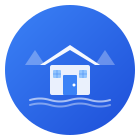
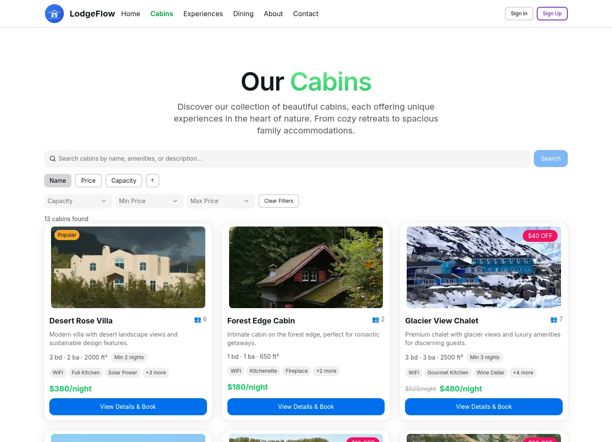
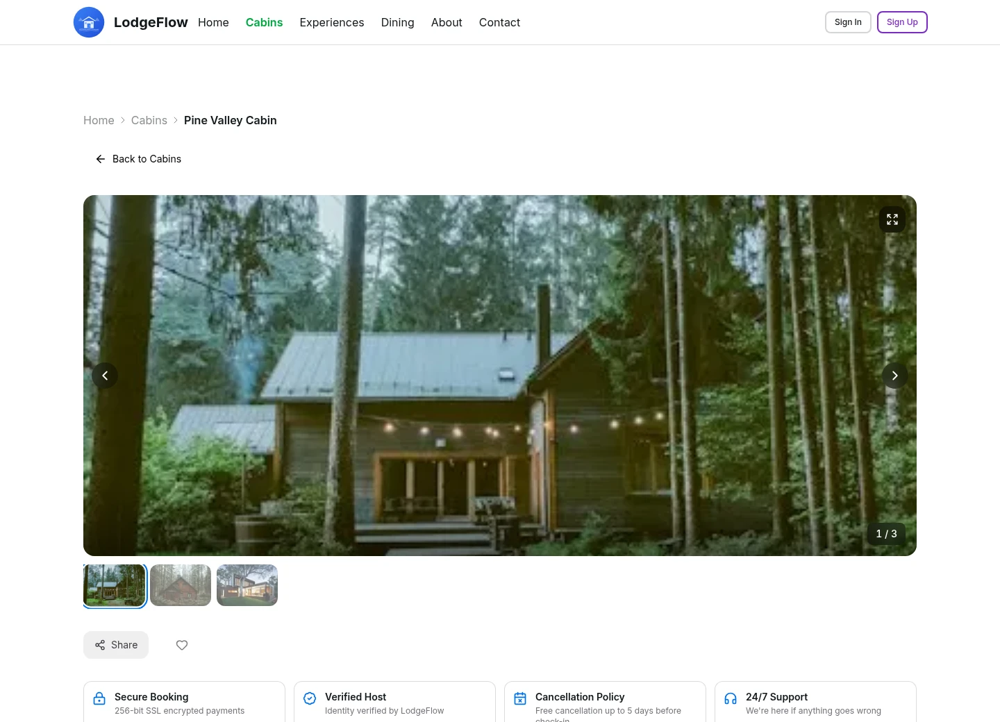
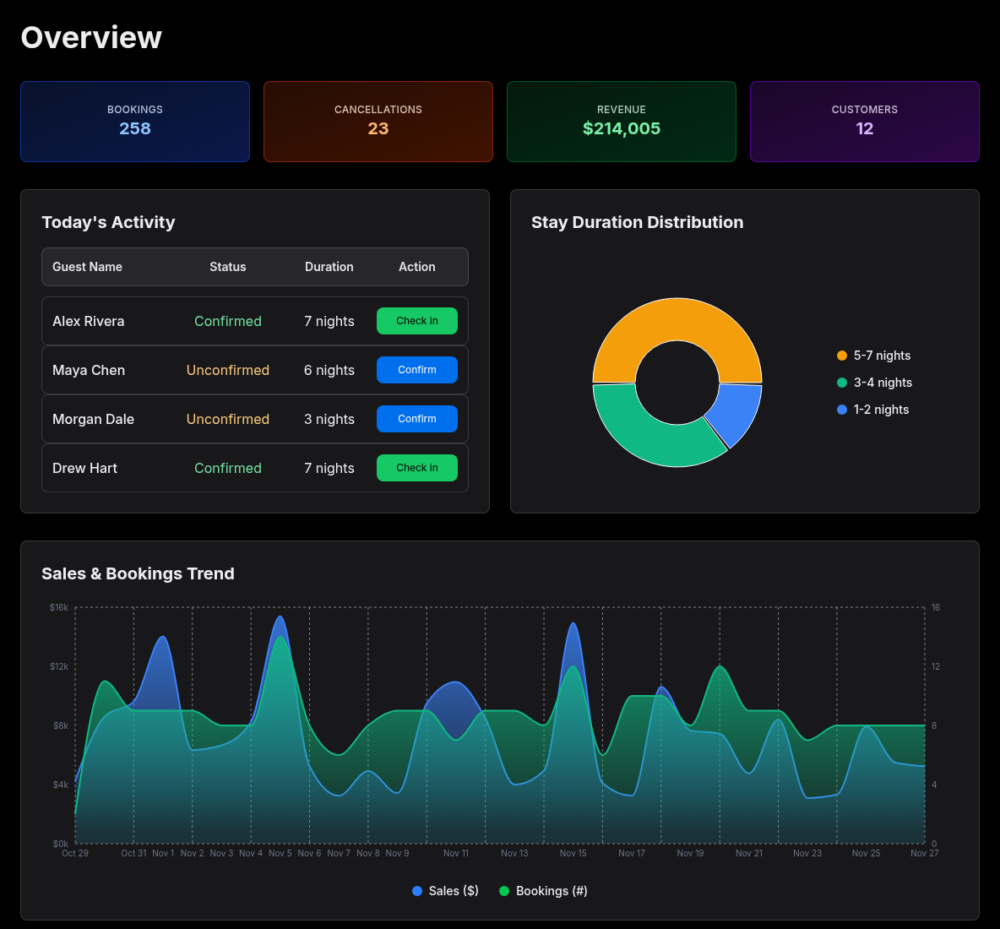
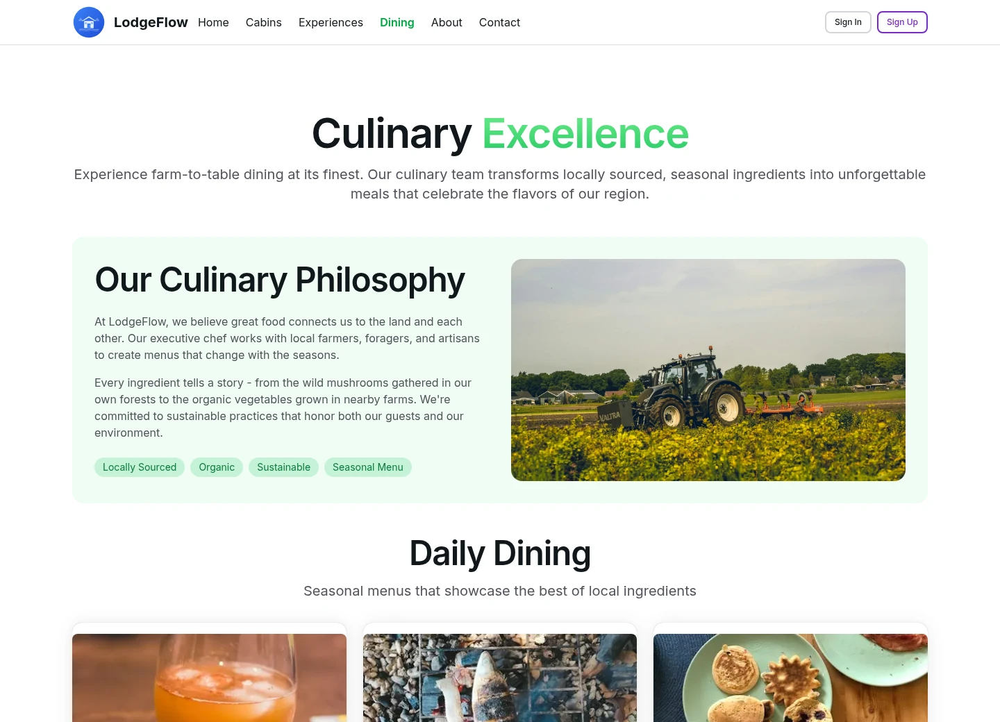
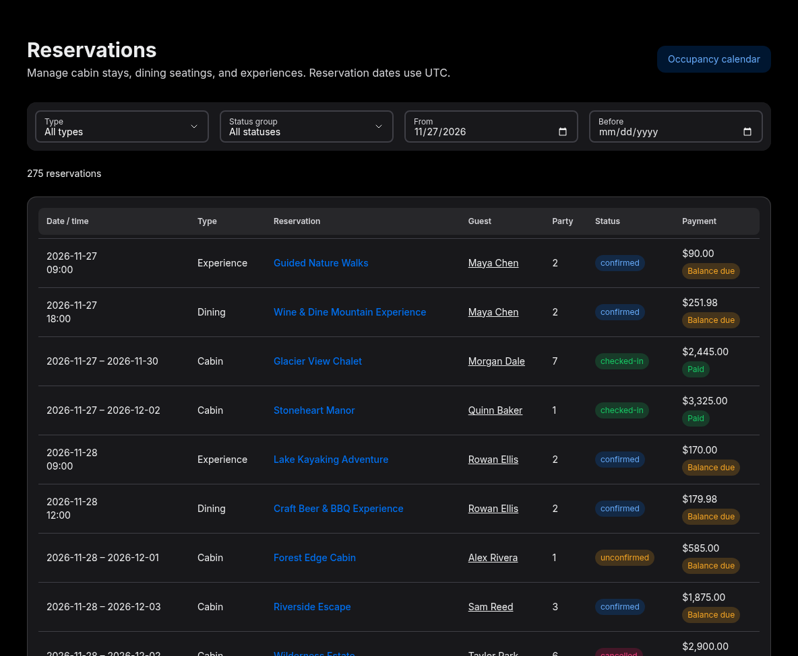
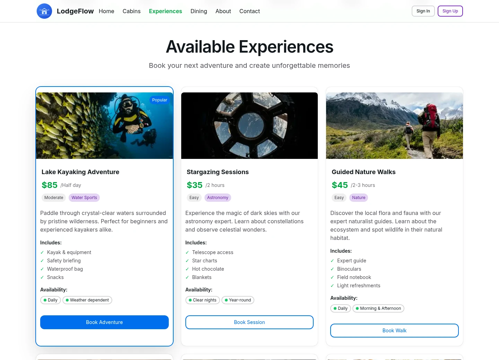
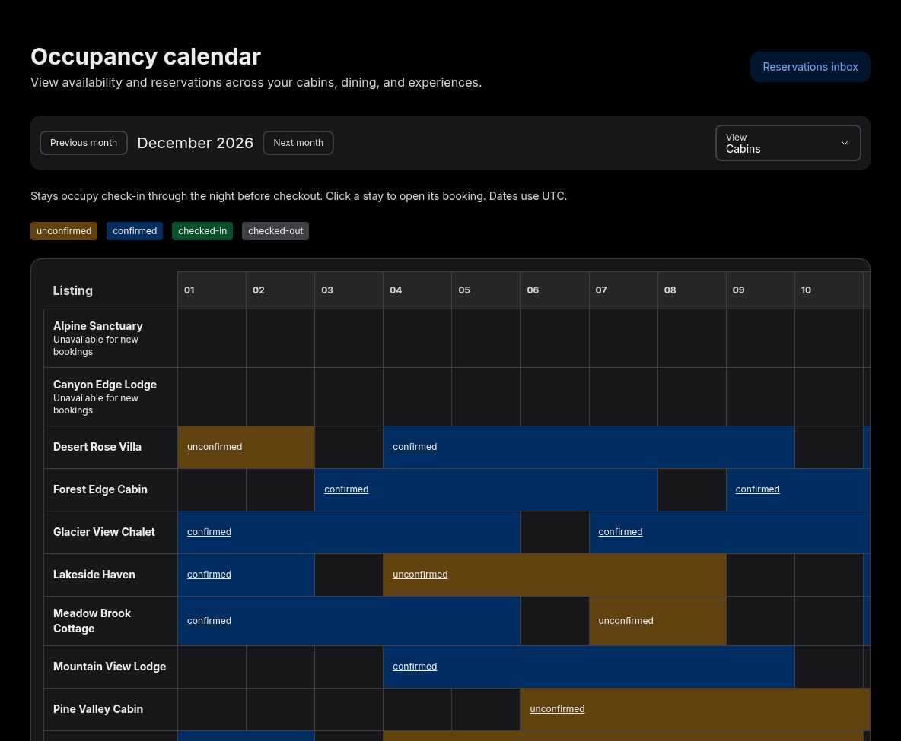

# LodgeFlow

LodgeFlow runs the guest booking site and staff dashboard for a wilderness lodge. Guests can reserve a cabin, a dining experience, or a guided activity. At the front desk, those reservations appear in one inbox and one occupancy calendar.

**[Browse the guest site](https://lodgeflow.app)** · **[Open the staff dashboard](https://admin.lodgeflow.app)** (test account on the sign-in page)

The screenshots show the local apps with sample reservations and fictional guests.

## Highlights

- **Availability.** A per-cabin lock prevents overlapping stays. Dining counts seats for each seating time on a given date. Experiences count participants across the whole day. [Cabin booking lock](packages/database/src/models/CabinBookingLock.ts) · [Reservation capacity](packages/database/src/reservation-capacity.ts)
- **Pricing and payments.** The server prices a stay and calculates its required deposit from the cabin, selected extras, and property settings. Receipts determine how much the guest has paid and what staff can refund. Guests can pay through Stripe Checkout, and staff can record money received at the property. [Booking payments](packages/database/src/booking-payments.ts) · [Dining and experience payments](docs/reservation-payments.md)
- **Staff permissions.** Front desk staff manage reservations and record payments. Managers can also issue refunds and review audit history. Administrators assign staff roles. Staff APIs verify Clerk organization membership and the application role stored in MongoDB. [Staff access](apps/admin/lib/staff-access.ts) · [Permissions](apps/admin/lib/permissions.ts)

<strong>More screens</strong> · Guest booking and front desk operations

| Guest site                                                                                                                                             | Staff dashboard                                                                                                                                         |
| ------------------------------------------------------------------------------------------------------------------------------------------------------ | ------------------------------------------------------------------------------------------------------------------------------------------------------- |
|                                |  |
|                                         |   |
|  |                 |

## Tech stack

| Layer                 | Technology                                                                |
| --------------------- | ------------------------------------------------------------------------- |
| Applications          | Next.js 16 App Router, React 18, TypeScript, HeroUI v2, Tailwind CSS v4   |
| Data                  | MongoDB and Mongoose, shared through `@lodgeflow/database`                |
| Client state          | SWR and TanStack Query                                                    |
| Identity and payments | Clerk, Stripe Checkout and signed webhooks                                |
| Email                 | Resend, React Email and shared sender configuration in `@lodgeflow/email` |

## Documentation

| Guide                                                                   | Covers                                                                  |
| ----------------------------------------------------------------------- | ----------------------------------------------------------------------- |
| [Contributing](CONTRIBUTING.md)                                         | Set up both apps, run checks, and open a pull request                   |
| [Admin API](docs/api.md)                                                | Staff permissions, endpoints, and response formats                      |
| [Reservation payments](docs/reservation-payments.md)                    | Collection, refunds, and recovery after an interrupted payment          |
| [Stripe webhook diagnostics](docs/stripe-webhook-diagnostics.md)        | Investigating checkout and settlement                                   |
| [Guest identity](docs/guest-identity.md)                                | Resolving Clerk identities for staff reservation views                  |
| [HTTP smoke tests](docs/refactoring/http-smoke.md)                      | Running the isolated API and provider checks                            |
| [Agent guide](AGENTS.md) · [Refactoring plan](docs/refactoring/plan.md) | Workspace conventions, delivered changes, and remaining acceptance work |

## License

[MIT](LICENSE) · Built by [Amadou](https://github.com/Amadou-dot)

<!-- Project README template: https://github.com/Amadou-dot/Amadou-dot/blob/main/templates/project/README.md -->
